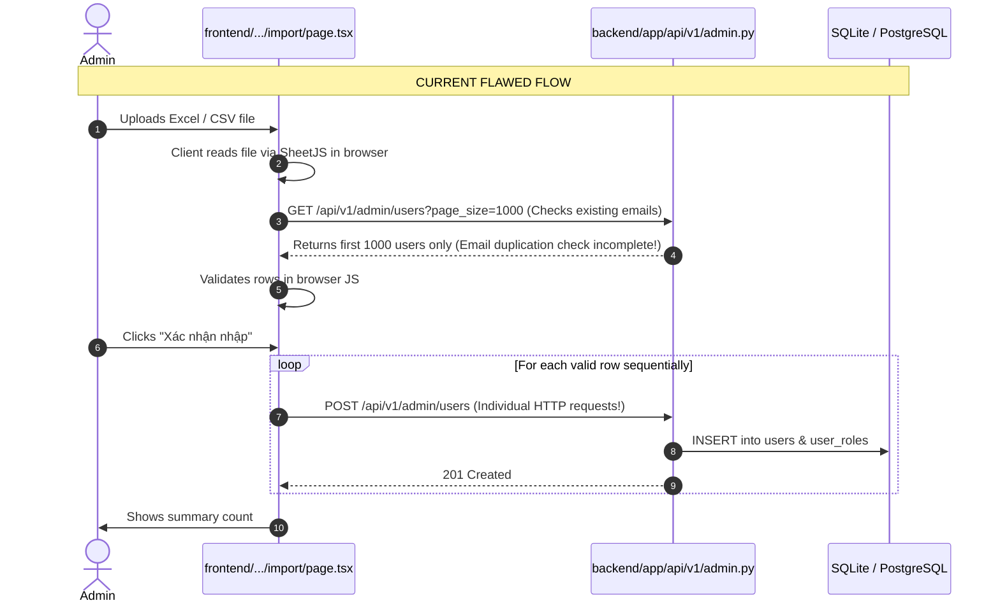
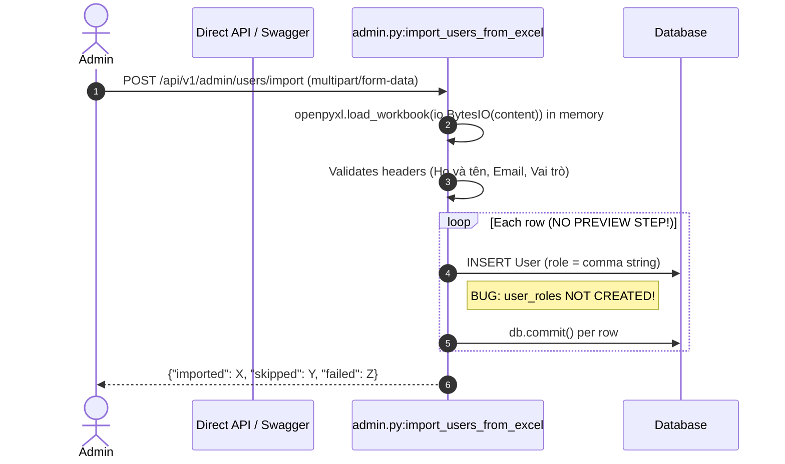

# 23 — Pagination and Bulk Import Current-State Audit

**Written for:** Project Team, Product Owner, and QA Automation Team  
**Repository:** `D:/TTCS_CODE_GYM/internal-recruiment-system-k3s4-n4-team`  
**Baseline Commit / Branch:** `feature/develop`  
**Execution Date:** 2026-10-13  
**Auditor Roles:** Principal Software Architect, Senior FastAPI Engineer, Senior Next.js Engineer, Database Architect, QA Automation Engineer  

---

## 1. Executive Summary

This audit establishes the ground truth of pagination, filtering, searching, sorting, and Excel bulk user import across the Enterprise Internal Recruitment System (**TTCS_T926_K3S4**).

Prior to proposing or implementing any changes, the repository source code was audited against:
1. The **Product Backlog Excel workbook** (`HỆ THỐNG TUYỂN DỤNG NỘI BỘ_ TTCS_T926_K3S4.xlsx`), specifically **S1-08** (User Management, filters, and pagination) and **S2-01** (Excel employee import, validation, preview, partial import, and summary).
2. The **Test Cases workbook** (`ATS_Test_Cases_TTCS_T926_K3S4.xlsx`), specifically test cases `TC-S1-08-01` through `TC-S1-08-04`, `TC-S1-08-X01`, `TC-S2-01-01` through `TC-S2-01-03`, and `TC-S2-01-X01`.
3. All previous audit reports in `reports/` (reports 01 to 16).
4. Automated verification: Backend pytest suite passed **155/155 tests (100%)**; Frontend TypeScript static typecheck passed with **0 errors**.

### Key Baseline Findings

1. **User Management (`/admin/users`) is Severely Disconnected**:
   - The backend (`backend/app/api/v1/admin.py:list_users`) provides an offset/limit endpoint with `page`, `page_size`, `total`, `pages`, and `items`.
   - However, the frontend (`frontend/src/app/admin/users/page.tsx`) completely ignores this API and runs entirely on `MOCK_USERS_150` (150 hardcoded mock users in `components/mockData.ts`). All pagination, search, status filtering, role filtering, account locking, and user creation are performed client-side in React state.
   - The backend `list_users` lacks sort parameters (`sort_by`, `sort_order`), and only sorts by `User.created_at.desc()`.

2. **Excel Import Workflow is Broken and Lacks Server-Side Preview**:
   - In the backend (`backend/app/api/v1/admin.py:import_users_from_excel`), the endpoint `POST /api/v1/admin/users/import` directly creates users synchronously in the database in a loop. It has **no preview endpoint** (violating S2-01 AC2: "Xem trước và báo lỗi theo từng dòng trước khi nhập").
   - **Critical RBAC Bug**: When `import_users_from_excel` creates a user, it only populates `user.role` (the legacy comma-separated string) and fails to create records in `user_roles` (the normalized multi-role table). Consequently, imported users cannot be filtered by role in `list_users` and cannot have permissions evaluated properly by `rbac_service`.
   - In the frontend, `frontend/src/app/admin/users/import/page.tsx` parses Excel files client-side using SheetJS (`xlsx`), attempts client-side validation against a 1000-user query to `http://localhost:8000/api/v1/admin/users`, and then executes sequential HTTP `POST` requests in a browser loop for each valid row. On network error, its catch block erroneously increments `successCount++`.
   - The modal `frontend/src/app/admin/users/components/ExcelImportModal.tsx` is completely mocked using `setTimeout` and fake arrays.

3. **Global Server-Side Pagination is Missing Across Domain Endpoints**:
   - Major domain list endpoints (`/requisitions`, `/jobs`, `/jobs/admin-list`, `/applications`, `/interviews`, `/offers`, `/talent-pool`, `/hr/departments`, `/hr/positions`) query with `.all()` without offset, limit, or total count metadata.
   - While `Pagination.tsx` exists in `frontend/src/components/ui/Pagination.tsx` and has high visual quality, it is not connected to server-side query parameters across the major data tables.

---

## 2. Requirement Grounding Matrix (Product Backlog & Test Cases)

| Story ID | Role | Requirement Summary | Acceptance Criteria (AC) | Mapped Test Cases | Current Status |
|---|---|---|---|---|---|
| **S1-08** | Quản trị hệ thống | Quản trị người dùng, tìm kiếm, phân quyền, phân trang | 1. Tạo tài khoản gửi email kích hoạt kèm mật khẩu tạm 2. Email trùng bị từ chối kèm thông báo cụ thể 3. Tìm theo tên, email, phòng ban; lọc theo vai trò và trạng thái 4. Danh sách phân trang, mặc định 20 dòng | TC-S1-08-01 TC-S1-08-02 TC-S1-08-03 TC-S1-08-04 TC-S1-08-X01 | **PARTIALLY IMPLEMENTED / MOCKED IN FRONTEND** - Backend API exists but lacks sort params. - Frontend runs on `MOCK_USERS_150`. |
| **S2-01** | Quản trị hệ thống | Nhập danh sách nhân sự hàng loạt từ Excel | 1. Tải được tệp mẫu 2. Xem trước và báo lỗi theo từng dòng trước khi nhập 3. Dòng lỗi bị bỏ qua, dòng hợp lệ vẫn được nhập, có báo cáo tổng kết | TC-S2-01-01 TC-S2-01-02 TC-S2-01-03 TC-S2-01-X01 | **BROKEN / INCOMPLETE** - Backend lacks Preview endpoint. - Backend fails to assign normalized `user_roles`. - Frontend performs sequential client-side POST loop or fake modal. |
| **S3-08** | Trưởng phòng Nhân sự | Danh sách yêu cầu tuyển dụng kèm bộ lọc & cảnh báo trễ hạn | Lọc theo trạng thái, phòng ban, recruiter, thời gian; tính ngày mở và cảnh báo trễ hạn | TC-S3-08-01 TC-S3-08-02 | **BACKEND-ONLY** List returns all rows (`.all()`), no server pagination. |
| **S4-01** | Ứng viên / Public | Tìm kiếm việc làm công khai | Tìm theo từ khóa, lọc theo phòng ban, địa điểm, hình thức | TC-S4-01-01 TC-S4-01-03 | **BACKEND-ONLY** List returns all published postings (`.all()`), no pagination envelope. |
| **S5-01** | Chuyên viên tuyển dụng | Quản lý danh sách ứng viên & sàng lọc | Tìm kiếm theo tên, email, SĐT; lọc theo vị trí, trạng thái, đánh giá | TC-S5-01-01 TC-S5-01-03 | **BACKEND-ONLY** List returns all visible applications (`.all()`), no pagination envelope. |
| **S6-01** | Chuyên viên tuyển dụng | Xuất danh sách ứng viên ra Excel theo bộ lọc | Xuất theo bộ lọc đang áp dụng; không chứa ghi chú nhạy cảm | TC-S6-01-01 | **IMPLEMENTED** |
| **S7-04** | Chuyên viên tuyển dụng / HR | Danh sách và quản lý Offer | Quản lý đề xuất offer theo trạng thái và thẩm quyền | TC-S7-04-01 | **BACKEND-ONLY** List returns all visible offers (`.all()`), no pagination. |

---

## 3. Comprehensive Data Table & List Inventory

| # | Entity / Module | Frontend File | Backend Route | Database Model | Exists? | Pagination Location | Searching | Filtering | Sorting | Classification |
|---|---|---|---|---|---|---|---|---|---|---|
| 1 | User Management | `admin/users/page.tsx` | `GET /api/v1/admin/users` | `User`, `UserRole`, `Role` | Yes | Backend has limit/offset; Frontend is Client Mock | Client (mock) | Client (mock) | None | **MOCKED IN UI / PARTIAL BE** |
| 2 | Excel Import Preview | `admin/users/import/page.tsx` | Missing Preview endpoint | `User` (staging missing) | Partial | None (client array) | None | Client only | None | **BROKEN / INCOMPLETE** |
| 3 | Audit Logs | `admin/audit-logs/page.tsx` | `GET /api/v1/admin/audit-logs` | `AuditLog` | Yes | Backend hardcoded `limit(100)` | Yes (actor/action) | Yes (module) | Fixed desc | **NEEDS IMPROVEMENT** |
| 4 | Email Logs | `hr/automation/email-logs/page.tsx` | `GET /api/v1/email-automation/logs` | `EmailLog` | Yes | Backend hardcoded `limit(500)` | Yes (query) | Yes (status) | Fixed desc | **NEEDS IMPROVEMENT** |
| 5 | Requisitions | `hr/requisitions/page.tsx` | `GET /api/v1/requisitions` | `JobRequisition` | Yes | None (`.all()`) | No | Yes (dept, status, rec) | Fixed desc | **BACKEND-ONLY (NO PAGINATION)** |
| 6 | Job Postings (Admin) | `hr/jobs/page.tsx` | `GET /api/v1/jobs/admin-list` | `JobPosting` | Yes | None (`.all()`) | No | Yes (status) | Fixed desc | **BACKEND-ONLY (NO PAGINATION)** |
| 7 | Job Postings (Public) | `app/jobs/page.tsx` | `GET /api/v1/jobs` | `JobPosting` | Yes | None (`.all()`) | Yes (query) | Yes (dept, loc, type) | Fixed desc | **BACKEND-ONLY (NO PAGINATION)** |
| 8 | Candidates / Applications | `hr/candidates/page.tsx` | `GET /api/v1/applications` | `JobApplication` | Yes | None (`.all()`) | Yes (query) | Yes (job, status, tag) | In-memory sort | **BACKEND-ONLY (NO PAGINATION)** |
| 9 | Interview Schedules | `hr/interviews/page.tsx` | `GET /api/v1/interviews` | `InterviewSchedule` | Yes | None (`.all()`) | No | Yes (app, status, mine) | Fixed asc | **BACKEND-ONLY (NO PAGINATION)** |
| 10 | Job Offers | `hr/offers/page.tsx` | `GET /api/v1/offers` | `JobOffer` | Yes | None (`.all()`) | No | Yes (status) | Fixed desc | **BACKEND-ONLY (NO PAGINATION)** |
| 11 | Talent Pool | `hr/talent-pool/page.tsx` | `GET /api/v1/talent-pool` | `TalentPoolEntry` | Yes | None (`.all()`) | Yes (query) | Yes (title) | Fixed desc | **BACKEND-ONLY (NO PAGINATION)** |
| 12 | Departments | `hr/master-data/departments/page.tsx` | `GET /api/v1/hr/departments` | `Department` | Yes | None (`.all()`) | No | Active only | Fixed order | **COMPLETE (Master Data)** |
| 13 | Positions / Job Titles | `hr/master-data/positions/page.tsx` | `GET /api/v1/hr/positions` | `JobTitle` | Yes | None (`.all()`) | No | Active only | Fixed name | **COMPLETE (Master Data)** |
| 14 | In-app Notifications | `personal/NotificationListView.tsx` | `GET /api/v1/notifications` | `Notification` | Yes | Limit 50 (unread_count) | No | Unread only | Fixed desc | **NEEDS IMPROVEMENT** |

---

## 4. Current Excel Bulk User Import Traceability

### 4.1 As-Is Execution Flow Analysis

### 4.2 Alternative As-Is Backend Endpoint (`POST /api/v1/admin/users/import`)

### 4.3 Confirmed Defects in Excel Import

1. **Defect IMP-01 (Missing Staged Preview API)**:  
   The backend lacks an endpoint to parse, validate, and return a preview of the Excel file with row-level validation statuses before committing to the database. S2-01 AC2 mandates: *"Xem trước và báo lỗi theo từng dòng trước khi nhập"*.
2. **Defect IMP-02 (Missing Role Assignment Persistence)**:  
   In `backend/app/api/v1/admin.py:import_users_from_excel` (lines 505-517), `new_user` is committed with `role=role_str`, but `replace_user_roles(db, new_user, valid_user_roles)` is **never invoked**. As a result, no rows are inserted into `user_roles`. This causes all imported users to lack RBAC role mappings, preventing them from being filtered by role or granted functional permissions.
3. **Defect IMP-03 (Dangerous Client-Side Sequential Loop in Import Page)**:  
   `frontend/src/app/admin/users/import/page.tsx` (lines 241-265) executes sequential browser `fetch` calls for each row to hardcoded `http://localhost:8000/api/v1/admin/users`. For a 500-user or 5,000-user sheet, this creates severe browser latency, memory pressure, and network failures. Furthermore, line 264 increments `successCount++` on catch exceptions.
4. **Defect IMP-04 (Mocked Excel Import Modal)**:  
   `frontend/src/app/admin/users/components/ExcelImportModal.tsx` does not communicate with any API; it uses simulated timers (`setTimeout`) and generates 15 fake users locally in memory.
5. **Defect IMP-05 (Incomplete In-Memory File Processing and Lack of Staging Table)**:  
   `openpyxl.load_workbook` loads the whole file buffer in memory at once. For large Excel imports, this risks memory spikes. There is no job tracking or staging persistence to support paginated preview, asynchronous batch processing, or progress tracking.

---

## 5. Current Pagination Architecture Audit

### 5.1 Backend Pagination Inventory

| Endpoint | Parameters | Sort Support | Count Support | Pagination Envelope | Status |
|---|---|---|---|---|---|
| `GET /api/v1/admin/users` | `search`, `status`, `role`, `page`, `page_size` | No (hardcoded `created_at desc`) | Yes (`query.count()`) | `{"items", "total", "page", "page_size", "pages"}` | Needs sorting & department filter |
| `GET /api/v1/admin/audit-logs` | `actor`, `action`, `module` | No (hardcoded `created_at desc`) | No (hardcoded `limit(100)`) | Flat array `List[dict]` | Needs standard pagination |
| `GET /api/v1/email-automation/logs` | `status`, `search` | No (hardcoded `sent_at desc`) | No (hardcoded `limit(500)`) | Flat array `List[dict]` | Needs standard pagination |
| `GET /api/v1/notifications` | `unread_only`, `limit` | No (hardcoded `created_at desc`) | Unread count only | `{"items", "unread_count"}` | Needs standard pagination |
| `GET /api/v1/requisitions` | `status_filter`, `department_id`, `recruiter_id`, `date_from`, `date_to`, `overdue_only` | No (hardcoded `created_at desc`) | None (calls `.all()`) | Flat array `List[dict]` | Needs standard pagination |
| `GET /api/v1/jobs` | `department`, `location`, `type`, `search` | No (hardcoded `created_at desc`) | None (calls `.all()`) | Flat array `List[dict]` | Needs standard pagination |
| `GET /api/v1/jobs/admin-list` | `status_filter` | No (hardcoded `created_at desc`) | None (calls `.all()`) | Flat array `List[dict]` | Needs standard pagination |
| `GET /api/v1/applications` | `job_id`, `status_filter`, `search`, `source`, `tag`, `rating_min`, `date_from`, `date_to`, `overdue_only`, `sort`, `mine` | Partial (in-memory `sort="match"`) | None (calls `.all()`) | Flat array `List[dict]` | Needs standard pagination |
| `GET /api/v1/interviews` | `application_id`, `status_filter`, `mine` | No (hardcoded `scheduled_time asc`) | None (calls `.all()`) | Flat array `List[dict]` | Needs standard pagination |
| `GET /api/v1/offers` | `status_filter` | No (hardcoded `created_at desc`) | None (calls `.all()`) | Flat array `List[dict]` | Needs standard pagination |
| `GET /api/v1/talent-pool` | `q`, `title` | No (hardcoded `created_at desc`) | None (calls `.all()`) | Flat array `List[dict]` | Needs standard pagination |

### 5.2 Frontend Pagination Inventory

- **Component**: `frontend/src/components/ui/Pagination.tsx` (re-exported by `components/Pagination.tsx`).
  - Implements clean UI with `currentPage`, `totalPages`, `onPageChange`, `totalItems`, `itemsPerPage`, `showItemCount`, `itemLabel`.
  - Supports ellipses for large page counts.
  - **Limitation**: Does not include a page size selector dropdown (`pageSizeOptions`), requiring each consumer to manually render or fix page sizes.
- **Consumer Pages**:
  - `admin/users/page.tsx`: Does not use `Pagination.tsx`; instead renders custom inline button controls linked to client-side sliced mock arrays.
  - `admin/audit-logs/page.tsx`: Renders a simple unpaginated list capped at 100 items.
  - `hr/candidates/page.tsx`: Uses custom client-side slicing or unpaginated table.
  - `hr/requisitions/page.tsx`: Uses unpaginated table.

---

## 6. Audit Verdict

1. **System Health**: Baseline test suite passes 100% (155/155 tests). TypeScript compilation has 0 errors. The system is structurally stable.
2. **Critical Gaps**:
   - S1-08 is compromised by the frontend relying on `MOCK_USERS_150` rather than connecting to `/api/v1/admin/users`.
   - S2-01 is broken by the absence of a server-side Preview endpoint, the missing `user_roles` assignment bug in the backend import routine, and the sequential browser-side POST loop in the frontend.
   - Global pagination across all major domain tables is absent at the database and API levels, risking performance degradation under growing datasets.
