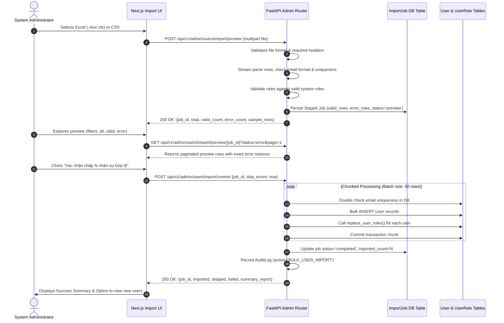

# 25 — Pagination and Import Implementation Plan

**Written for:** Engineering Leads, QA Automation Team, Product Owner  
**Repository:** `D:/TTCS_CODE_GYM/internal-recruiment-system-k3s4-n4-team`  
**Execution Date:** 2026-10-13  
**Status:** Approved for Implementation (Audit Gate Completed)  

---

## 1. Architectural Design

### 1.1 Global Pagination Architecture

To eliminate unbounded database queries while guaranteeing deterministic pagination, sorting, and filtering across all actors, we adopt the following standard:

```
┌────────────────────────────────────────────────────────┐
│                      Client UI                         │
│  (Page: 1, Size: 20, Sort: "created_at:desc", Filters) │
└──────────────────────────┬─────────────────────────────┘
                           │ HTTP GET with Query Params
                           ▼
┌────────────────────────────────────────────────────────┐
│                   FastAPI Route                        │
│          Depends(PaginationParams.as_query)            │
└──────────────────────────┬─────────────────────────────┘
                           │ Scoped SQLAlchemy Query
                           ▼
┌────────────────────────────────────────────────────────┐
│         backend/app/core/pagination.py                 │
│              paginate_query(query, params)             │
│  1. Apply search & business filters                    │
│  2. Count total records (SELECT COUNT(*))              │
│  3. Apply deterministic ORDER BY (sort_by + id)        │
│  4. Apply OFFSET (page-1)*size LIMIT size              │
│  5. Return PaginatedResponse[T] envelope               │
└──────────────────────────┬─────────────────────────────┘
                           │ JSON Response
                           ▼
┌────────────────────────────────────────────────────────┐
│  { "items": [...], "total": 142, "page": 1,            │
│    "page_size": 20, "pages": 8 }                       │
└────────────────────────────────────────────────────────┘
```

#### Pagination Contract
- **Query Parameters**:
  - `page`: Integer >= 1 (Default: 1)
  - `page_size`: Integer between 1 and 100 (Default: 20, options: 10, 20, 50, 100)
  - `sort_by`: String (Validated against allowed model attributes)
  - `sort_order`: String (`"asc"` or `"desc"`, default: `"desc"`)
  - `search`: String (Trimmed, case-insensitive substring search)
- **Response Envelope**:
  - `items`: List of serialized entities
  - `total`: Total count of matching records after security scoping and filtering
  - `page`: Current page number
  - `page_size`: Records per page
  - `pages`: Total number of pages (`max(1, ceil(total / page_size))`)

---

### 1.2 Scalable Staged Excel Import Architecture

To satisfy S2-01 (AC1: Template, AC2: Preview & row-level error reporting, AC3: Partial import & summary report), the bulk import is designed as a staged two-phase process:



---

## 2. Step-by-Step Implementation Order

### Phase 1: Core Pagination Infrastructure & User API (STEP 1)
1. **Create `backend/app/core/pagination.py`**:
   - Define `PaginationParams` with FastAPI dependency query parameters (`page`, `page_size`, `sort_by`, `sort_order`, `search`).
   - Define `PaginatedResponse[T]` Pydantic model with `items`, `total`, `page`, `page_size`, `pages`.
   - Implement `paginate_query(query, params, model, allowed_sort_columns)` ensuring deterministic secondary ordering (`model.id.desc()` or `model.id.asc()`).
2. **Update `backend/app/api/v1/admin.py:list_users`**:
   - Add `sort_by`, `sort_order`, and `department` parameters.
   - Validate sort columns against `["full_name", "email", "created_at", "employee_code", "department"]`.
   - Preserve existing response format `PaginatedUsersResponse` to guarantee 100% backward compatibility.
3. **Run Focused Tests**:
   - Verify `list_users` pagination, sorting ascending/descending, department filtering, and search.

### Phase 2: Database Staging Schema for Excel Import (STEP 2)
1. **Create Model `backend/app/models/import_job.py`**:
   - Table `import_jobs`:
     - `id`: Integer primary key
     - `job_id`: String (UUID) unique index
     - `filename`: String
     - `file_type`: String (xlsx, xls, csv)
     - `total_rows`: Integer
     - `valid_rows`: Integer
     - `error_rows`: Integer
     - `imported_rows`: Integer (default 0)
     - `status`: String (`pending`, `preview`, `importing`, `completed`, `failed`)
     - `stage_data_json`: Text (JSON string containing staged rows and row-level errors)
     - `created_at`: DateTime
     - `created_by_id`: Integer foreign key to `users.id`
2. **Create Alembic Migration**:
   - Generate `backend/alembic/versions/f7a1b2c3d4e5_import_jobs.py`.
   - Support both SQLite and PostgreSQL.
   - Execute and verify schema migration.

### Phase 3: Excel Import Preview & Batch Commit Implementation (STEP 3)
1. **Define Pydantic Schemas in `backend/app/schemas/admin.py`**:
   - `ImportRowPreview`: row number, full name, email, phone, employee code, department, roles, status (`VALID`, `ERROR`, `DUPLICATE`), error reason.
   - `ImportPreviewResponse`: job id, filename, total, valid count, error count, preview items, pages.
   - `ImportCommitRequest`: job id, skip_errors (boolean).
   - `ImportCommitResponse`: job id, total, imported, skipped, failed, summary.
2. **Implement Preview Endpoint in `backend/app/api/v1/admin.py`**:
   - `POST /api/v1/admin/users/import/preview`:
     - Validates file extension and size.
     - Streams and parses Excel/CSV.
     - Validates headers (`Họ và tên`, `Email`, `Vai trò`).
     - Validates rows: empty row detection, email RFC format, intra-file duplicates, DB duplicates (case-insensitive `lower(email)`).
     - Validates roles against `VALID_ROLES`.
     - Saves staged data in `ImportJob`.
     - Returns summary counts and first page of preview items.
   - `GET /api/v1/admin/users/import/preview/{job_id}`:
     - Allows paginated inspection of preview rows with status filter (`all`, `valid`, `error`).
3. **Implement Batch Commit Endpoint in `backend/app/api/v1/admin.py`**:
   - `POST /api/v1/admin/users/import/commit`:
     - Loads staged job by `job_id`.
     - Validates that job is in `preview` status.
     - Filters valid rows (or all if error count is 0).
     - Processes rows in chunks of 50.
     - For each row: generates temporary password, hashes password, creates `User`, flushes to get `user.id`, calls `replace_user_roles(db, user, valid_roles)`.
     - Commits each chunk atomically.
     - Updates `ImportJob` status to `completed` and records `AuditLog`.
4. **Fix Legacy Endpoint `POST /api/v1/admin/users/import`**:
   - Ensure `replace_user_roles()` is called for every created user so direct imports do not leave broken RBAC records.

### Phase 4: Shared Frontend Pagination & Admin Users Integration (STEP 4)
1. **Enhance `frontend/src/components/ui/Pagination.tsx`**:
   - Add optional `pageSize`, `onPageSizeChange`, and `pageSizeOptions = [10, 20, 50, 100]`.
   - Add a compact, clean select dropdown for items-per-page that matches Enterprise SaaS styling.
2. **Update `frontend/src/app/admin/users/page.tsx`**:
   - Remove `MOCK_USERS_150` dependency.
   - Add state for `currentPage`, `pageSize`, `searchQuery` (debounced 300ms), `roleFilter`, `statusFilter`, `sortBy`, `sortOrder`.
   - Fetch real data from `GET /api/v1/admin/users` via `apiRequest`.
   - Wire CRUD modals (Create User, Lock/Unlock User, Role Assignment) to real backend endpoints and refresh list on success.
   - Integrate shared `Pagination.tsx` component.
   - Display loading skeleton, empty state, and error toast.

### Phase 5: Excel Import Frontend Integration (STEP 5)
1. **Update `frontend/src/app/admin/users/import/page.tsx`**:
   - Step 1 (Upload): Uploads file to `POST /api/v1/admin/users/import/preview`.
   - Step 2 (Preview): Displays real server-validated rows, summary cards (Total, Valid, Error), status tabs (Tất cả, Hợp lệ, Có lỗi), paginated row table with badge indicators and specific error messages.
   - Step 3 (Execute): Calls `POST /api/v1/admin/users/import/commit`.
   - Step 4 (Summary): Shows completion statistics, links to `/admin/users` to view newly imported users, and error export if any rows failed.
2. **Update `frontend/src/app/admin/users/components/ExcelImportModal.tsx`**:
   - Wire file selection to backend `POST /api/v1/admin/users/import/preview` and `POST /api/v1/admin/users/import/commit` instead of fake `setTimeout` logic.

### Phase 6: Domain APIs & Tables Pagination (STEP 6)
1. **Apply `paginate_query` across domain routers**:
   - `requisitions.py`: Support `page`, `page_size`, `sort_by`, `sort_order`.
   - `jobs.py`: Support `page`, `page_size` for public portal and admin list.
   - `applications.py`: Support `page`, `page_size`, `sort_by`, `sort_order` for candidates list.
   - `email_automation.py`: Support `page`, `page_size` for email logs.
   - `admin.py`: Support `page`, `page_size` for audit logs.
   - In all routers, ensure unpaginated calls or backward-compatible defaults return expected formats.

### Phase 7: Verification & Regression Testing (STEP 7)
1. Run full backend pytest suite (all 155 baseline tests must continue passing).
2. Write dedicated regression tests for:
   - User list pagination, sorting, search, and department filter.
   - Excel template download.
   - Excel import preview (valid file, file with invalid emails, duplicate rows, missing headers).
   - Excel import batch commit with normalized `user_roles` persistence.
   - Partial import behavior (valid rows imported, error rows skipped).
3. Run frontend TypeScript typecheck (`tsc --noEmit`) and ESLint.
4. Verify database persistence with direct SQLite/PostgreSQL queries.
5. Create final report: `reports/26_pagination_and_import_implementation_results.md`.

---

## 3. Risk Mitigation & Compatibility Safeguards

| Potential Risk | Severity | Mitigation Strategy |
|---|---|---|
| Breaking existing test suites | High | Preserve all existing endpoint signatures and default parameters. Run pytest continuously. |
| Database lockup during large imports | Medium | Chunk transactions into 50-row batches with explicit commits per chunk. |
| Role assignment failure | High | Enforce transactional atomicity per user: `db.add(user)`, `db.flush()`, `replace_user_roles(db, user, roles)`, `db.commit()`. |
| Out-of-memory on large Excel files | Medium | Stream rows using `openpyxl.load_workbook(read_only=True)` or bounded line reading. |
| Breaking existing frontend consumers | Low | Extend `PaginationProps` with optional properties; maintain all existing prop defaults. |

---

## 4. Audit Gate Approval

- [x] Read and understand entire repository structure.
- [x] Grounded against Product Backlog stories S1-08 and S2-01.
- [x] Grounded against ATS Test Cases workbook.
- [x] Baseline automated test run verified (155/155 tests passed).
- [x] File-Level Impact Analysis completed (`reports/24_file_level_impact_analysis.md`).
- [x] Implementation Plan completed (`reports/25_pagination_and_import_implementation_plan.md`).

**Audit Gate Status:** **PASSED — PROCEED TO IMPLEMENTATION**
